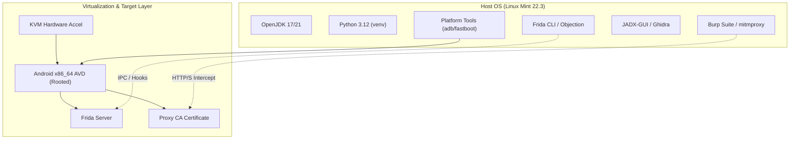

# Mobile App Security Lab — Linux Mint Baseline Audit

- **Date:** 2026-08-30
- **Host / Model:** Dell OptiPlex 3070
- **Operating System:** Linux Mint 22.3 (Zena) / Ubuntu 24.04 LTS base (Kernel 7.0.0-30-generic)
- **Architecture:** x86_64

---

## 1. Hardware & System Resources

| Parameter | Value | Assessment |
| :--- | :--- | :--- |
| **Processor (CPU)** | Intel Core i3-9100T (4 cores / 4 threads @ 3.10 GHz) | Capable of running x86_64 AVDs and decompilers |
| **System Memory (RAM)**| 15 GiB Total (~13 GiB Available) | Sufficient for running emulators (3-4 GB allocated) + IDEs + Proxies |
| **Root Disk Storage** | 125 GB partition (89 GB available on ext4) | Sufficient for Android SDKs, images, and tools |
| **Hardware Virtualization** | KVM active (`/dev/kvm` present, VMX enabled) | Hardware acceleration for Android AVDs ready |

---

## 2. Tooling & Environment Inventory

### Core Runtimes & Dependencies
- **Java (JDK/JRE):** `NOT INSTALLED` *(Required: OpenJDK 17 or 21)*
- **Python 3:** `Python 3.12.3` *(Missing: pip3, venv)*
- **Node.js / npm:** `v18.19.1` / `npm 9.2.0` *(Installed)*
- **Git:** `2.43.0` *(Installed)*
- **Container Engine (Docker/Podman):** `NOT INSTALLED` *(Recommended for MobSF)*

### Mobile Bridge & Analysis Utilities
- **ADB & Fastboot:** `NOT INSTALLED`
- **JADX / JADX-GUI:** `NOT INSTALLED`
- **Apktool:** `NOT INSTALLED`
- **Frida / Objection:** `NOT INSTALLED`
- **Ghidra / Radare2:** `NOT INSTALLED`
- **Burp Suite / mitmproxy:** `NOT INSTALLED`
- **Android SDK / Emulator:** `NOT INSTALLED`

---

## 3. Recommended Lab Architecture

---

## 4. Windows 11 Comparison Checklist

When running the equivalent audit under Windows 11 `agy`:

1. **Virtualization Support:**
   - Check if WSL2 / Hyper-V or Windows Hypervisor Platform (WHPX) is enabled for Android Studio Emulator.
2. **Environment & Paths:**
   - Verify Java JDK (e.g., Microsoft OpenJDK / Temurin 17/21) and `JAVA_HOME` environment variable.
   - Verify Python 3 & pip PATH configuration.
   - Check Android SDK location (`%LOCALAPPDATA%\Android\Sdk\platform-tools`).
3. **USB & Driver Interfacing:**
   - Under Windows, physical device debugging requires OEM USB drivers (Google USB Driver / manufacturer driver). Linux uses `udev` rules without extra driver installers.
4. **Proxy & Certificate Installation:**
   - Check ease of system certificate injection (Windows cert store vs Android emulator writable system `/system/etc/security/cacerts`).
